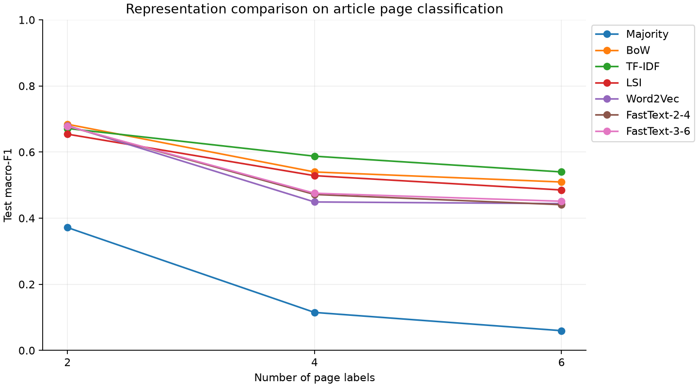
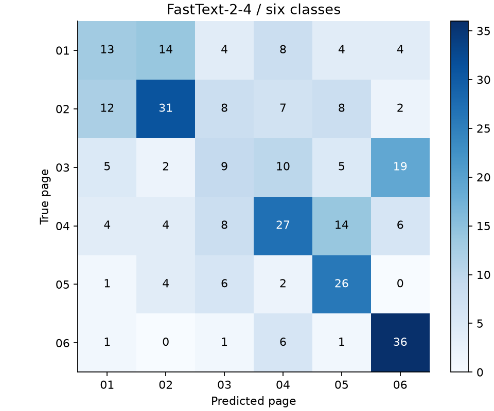

# Gensim 表示学习与 FastText 文本分类

《大语言模型与应用实践》HW2 实验报告

**GitHub：** [项目仓库](https://github.com/0001Henry/LLM-P) · [HW2 源代码](https://github.com/0001Henry/LLM-P/tree/main/hw2) · [在线实验报告](https://github.com/0001Henry/LLM-P/blob/main/hw2/REPORT.md) · [实验结果](https://github.com/0001Henry/LLM-P/tree/main/hw2/results)

## 摘要

本实验使用人民日报一月文章进行版面分类，比较 BoW、TF-IDF、LSI、Word2Vec 和两种字符 n-gram 配置的 FastText。表示模型在一月训练文本和二月新闻上训练，分类器统一采用逻辑回归，通过验证集选择正则化参数，并分别测试 2、4、6 类任务。

按六分类验证集选出的配置为 **FastText-2-4**，独立测试 Accuracy 为 **0.4551**，Macro-F1 为 **0.4408**。本次 FastText 采用词向量均值与逻辑回归的两阶段分类方式。它能够为未登录词生成向量，但六分类效果仍低于 TF-IDF，说明词向量覆盖范围更广并不一定带来更好的分类结果。

**关键词：** Gensim；FastText；词向量；文本分类；未登录词

## 1. 实验任务

1. 了解 Gensim 的词典、稀疏语料、向量模型和模型持久化接口，完成不同表示方法的训练与应用。
2. 训练 FastText，将文章映射为固定维度向量，完成从少类别到多类别的分类实验。
3. 对照子词表示论文和高效率分类论文阅读源码，说明核心计算、数据管线及超参数作用。

实验对应课程课件 L2.part1 第 137 页，全部使用本地 CPU，未加载预训练词向量。训练后保存表示模型和分类器，并重新加载进行预测。

## 2. 数据、标签与划分

### 2.1 数据来源与标签定义

数据来自课程随附的 `1998-上半年-带音(1).rar`。一月语料用于分类，另选二月语料作为新闻风格一致的无标签表示学习文本。二月数据属于独立月份，不是额外人工标注的分类样本。

原始编号形如 `19980101-06-001-002`，依次对应日期、版面、文章和段落。本文选择 **01 至 06 版的版面号**作为六个类别。二分类使用 01、02 版，四分类增加 03、04 版，六分类再增加 05、06 版。

模型根据正文预测版面号。由于同一版面在不同日期可能刊登不同内容，本文保留原始版面编号，不将其命名为经济、体育等主题。结果反映的是版面分类效果，而非通用主题分类能力。编号仅用于聚合、划分和错误定位，不进入模型特征。

### 2.2 清洗与分词

以 GB18030 读取原文，去除编号、分词空格及花括号读音注释，按文章 ID 聚合段落并按段落序号排序。采用 NFKC 规范化并转小写，再用 jieba（`HMM=False`）统一重新分词。仅保留汉字词或英文字母词，去除纯数字、标点及其他符号；不使用外部停用词表，保留单字词。采用统一分词规则是为了保证训练与新文本推理一致。

按分词后拼接文本的摘要去除完全重复文章，过滤不足 30 个 token 的文章。对每个类别分别固定种子 42 打乱，按约 70%/15%/15% 划分训练、验证和测试文章。文章的各段落始终属于同一集合。

| 版面标签 | 训练文章 | 验证文章 | 测试文章 |
| --- | --- | --- | --- |
| 01 | 217 | 47 | 47 |
| 02 | 315 | 67 | 68 |
| 03 | 230 | 49 | 50 |
| 04 | 291 | 63 | 63 |
| 05 | 182 | 39 | 39 |
| 06 | 207 | 44 | 45 |

### 2.3 表示学习语料与数据隔离

表示语料由一月训练文章中的段落和随机抽取的 **4,000 个二月段落**组成。二月段落排除与一月任何段落完全相同的文本；一月训练段落若与留出文章的段落完全相同，也不用于表示训练。段落按最多 128 个 token 切成训练单元，丢弃不足 3 个 token 的尾片段。最终得到 **12,571 个单元、625,843 个 token**。

所有表示方法使用同一份无标签语料建立词典或训练向量，验证集和测试集不参与 IDF、LSI 或词向量拟合。去重过程仅比较文本是否重复，不利用留出标签优化特征。分类器只使用一月训练标签。

2、4、6 类实验共享六类训练部分建立的表示模型，因此较少类别的任务也使用了其余类别的无标签训练文本。各任务的类别集合和样本规模同时变化，分数差异不能只归因于类别数量。二月文本参与了一月分类的表示学习，本实验不属于跨月未来预测。

上述去重只能排除完全重复，无法排除改写报道和近重复内容。分类时仍输入整篇文章，不同集合的文章可能共享部分措辞或段落。后续还需要时间外推测试，检查模型对其他时期新闻的适用性。

## 3. 表示学习方法

### 3.1 BoW、TF-IDF 与 LSI

使用 `gensim.corpora.Dictionary` 建立词典，过滤少于两个训练单元出现的词、超过 95% 单元出现的词，最多保留 20,000 个词。本次词典实际包含 **20,000 个词**。`doc2bow` 将文章映射为词频向量，BoW 在分类前进行 L2 归一化。

`TfidfModel` 在表示训练语料上估计 IDF，将高频但区分度低的词降权，并使用默认归一化。其文档频率的统计单位是上述训练单元，而不是测试文章。LSI 使用 `LsiModel` 对训练 TF-IDF 语料进行低秩投影，主题数为 64；分类文章投影到相同空间后再做 L2 归一化。

### 3.2 Word2Vec 与 FastText

Word2Vec 使用 Skip-gram 和负采样学习词级共现表示。FastText 在此基础上引入字符 n-gram，使词形内部片段能够共享参数，并允许为未进入整词词表的词构造向量。该设计来源于 [Bojanowski 等人的子词表示论文](https://aclanthology.org/Q17-1010/)。

两个 FastText 配置分别使用字符 n-gram 长度 2–4 和 3–6，其余显式参数相同。它们是字符片段，不是跨词的 bigram。词边界标记也参与子词构造。中文大量词长度较短，设置 2–4 用于观察较短字符片段的效果，但本文不预设其一定优于 3–6。

| 参数 | 本次设置 | 含义 |
| --- | --- | --- |
| vector_size | 64 | 稠密词向量维度 |
| window | 5 | 最大上下文窗口范围 |
| sg | 1 | Skip-gram，非 CBOW |
| negative / hs | 5 / 0 | 每个正例使用 5 个负样本，不启用层次 softmax |
| min_count | 3 | 整词最小出现次数 |
| sample | 0.001 | 高频词下采样阈值 |
| epochs | 5 | 表示语料训练轮数 |
| min_n / max_n | 2/4 或 3/6 | FastText 字符片段长度范围 |
| bucket | 50,000 | 子词哈希桶数量，控制内存并引入碰撞可能 |
| workers / seed | 1 / 42 | 单工作线程与固定随机种子 |
| PYTHONHASHSEED | 42 | 由完整实验入口在子进程启动前设置 |

文章表示为其可用词向量的算术平均，再进行 L2 归一化。Word2Vec 跳过词表外词；FastText 通过子词构造它们的向量。空的可用词集合返回零向量，交互预测则拒绝完全没有可用文字的输入。均值池化保留大致语义，但丢失文章词序和结构。

负采样训练提高中心词与真实上下文的内积分数，同时降低与负样本的分数；FastText 将中心词表示扩展为整词及字符片段的组合。记可用词向量为 v(w)，本实验在词向量训练后，用 `z = L2Normalize(mean(v(w)))` 计算文章表示，再训练分类器。

### 3.3 分类器与选择协议

所有非多数类基线均使用 `LogisticRegression(class_weight='balanced', max_iter=1000)`。在每项任务的验证集上比较 `C ∈ {0.1, 1, 10}`，按 Macro-F1 选取 C，同分时保留较小 C。C 越大正则化越弱。验证集不合并回训练集，选定后直接评估独立测试集。

另设置始终预测训练集中最多类别的 Majority 基线。主要指标为 Macro-F1，同时记录 Accuracy、Weighted-F1、每类 Precision/Recall/F1 及混淆矩阵。六分类演示使用的 FastText 变体也按验证 Macro-F1 选择，测试集只用于最终评价。

## 4. 实验结果

### 4.1 从二分类到六分类

| 类别数 | 表示方法 | 验证 Macro-F1 | 所选 C | 测试 Accuracy | 测试 Macro-F1 |
| --- | --- | --- | --- | --- | --- |
| 2 | Majority | 不调参 | — | 0.5913 | 0.3716 |
| 2 | BoW | 0.7023 | 10.0 | 0.6957 | 0.6841 |
| 2 | TF-IDF | 0.6747 | 0.1 | 0.6870 | 0.6714 |
| 2 | LSI | 0.6557 | 0.1 | 0.6609 | 0.6542 |
| 2 | Word2Vec | 0.6958 | 10.0 | 0.6870 | 0.6800 |
| 2 | FastText-2-4 | 0.7054 | 10.0 | 0.6870 | 0.6782 |
| 2 | FastText-3-6 | 0.6984 | 10.0 | 0.6870 | 0.6782 |
| 4 | Majority | 不调参 | — | 0.2982 | 0.1149 |
| 4 | BoW | 0.5772 | 10.0 | 0.5570 | 0.5398 |
| 4 | TF-IDF | 0.6061 | 10.0 | 0.6009 | 0.5875 |
| 4 | LSI | 0.5826 | 10.0 | 0.5395 | 0.5286 |
| 4 | Word2Vec | 0.4896 | 10.0 | 0.4649 | 0.4490 |
| 4 | FastText-2-4 | 0.4905 | 10.0 | 0.4912 | 0.4717 |
| 4 | FastText-3-6 | 0.5055 | 10.0 | 0.4956 | 0.4755 |
| 6 | Majority | 不调参 | — | 0.2179 | 0.0596 |
| 6 | BoW | 0.5578 | 10.0 | 0.5160 | 0.5094 |
| 6 | TF-IDF | 0.5999 | 1.0 | 0.5481 | 0.5399 |
| 6 | LSI | 0.5617 | 1.0 | 0.4936 | 0.4853 |
| 6 | Word2Vec | 0.4702 | 10.0 | 0.4551 | 0.4440 |
| 6 | FastText-2-4 | 0.5054 | 10.0 | 0.4551 | 0.4408 |
| 6 | FastText-3-6 | 0.4987 | 10.0 | 0.4647 | 0.4512 |



在六分类中，所有方法里验证 Macro-F1 最高的是 **TF-IDF**，其测试 Macro-F1 为 **0.5399**。FastText-2-4 和 FastText-3-6 的六分类测试 Macro-F1 分别为 **0.4408** 和 **0.4512**。这是单次固定划分的实测比较，未进行多种随机种子下的显著性检验，不能仅据小幅分差判定某个配置普遍更好。

TF-IDF 在本次六分类中更好，可能是因为它保留了与版面有关的具体词汇，而低维向量的均值池化削弱了这部分差异。不过，当前实验没有单独比较池化方式，还不能确定性能差距主要来自哪一环节。

### 4.2 选定 FastText 的六分类表现

| 版面 | Precision | Recall | F1 | 支持数 |
| --- | --- | --- | --- | --- |
| 01 | 0.3611 | 0.2766 | 0.3133 | 47 |
| 02 | 0.5636 | 0.4559 | 0.5041 | 68 |
| 03 | 0.2500 | 0.1800 | 0.2093 | 50 |
| 04 | 0.4500 | 0.4286 | 0.4390 | 63 |
| 05 | 0.4483 | 0.6667 | 0.5361 | 39 |
| 06 | 0.5373 | 0.8000 | 0.6429 | 45 |



矩阵行为真实版面，列为预测版面。表中各版面的召回率差异较大，说明模型对不同版面的识别并不均衡。不同版面之间的内容重叠可能增加分类难度，但仅凭混淆矩阵还无法确定具体误判原因。以下列出部分误判文章，便于回查原文：

| 文章 ID（仅用于定位） | 真实版面 | 预测版面 |
| --- | --- | --- |
| 19980112-01-003 | 01 | 02 |
| 19980120-01-008 | 01 | 05 |
| 19980108-01-004 | 01 | 03 |
| 19980124-01-003 | 01 | 04 |
| 19980104-01-002 | 01 | 02 |
| 19980115-01-005 | 01 | 05 |
| 19980119-01-003 | 01 | 06 |
| 19980106-01-010 | 01 | 02 |

### 4.3 训练开销、OOV 与近邻观察

| 词向量方法 | 表示训练时间/s | 全部文章向量化时间/s | 词表规模 | 测试词次 OOV 比例 | 可构造向量的 OOV 词次 |
| --- | --- | --- | --- | --- | --- |
| Word2Vec | 5.907 | 0.247 | 20457 | 9.50% | 0 |
| FastText-2-4 | 8.730 | 0.457 | 20457 | 9.50% | 7076 |
| FastText-3-6 | 7.637 | 0.376 | 20457 | 9.50% | 7076 |

本次两个 FastText 配置的表示训练和文章向量化均比 Word2Vec 耗时更长。时间由 `perf_counter` 在本机 CPU 上测量一次：表示训练包含模型建立与训练，不包含保存；向量化包含三个分类集合的文章均值表示与归一化。分类器的 C 搜索时间和测试预测时间另存于 `results/metrics.json`。由于没有重复测速或峰值内存监测，这些记录仅用于说明本次运行开销。

OOV 按词是否存在于 `wv.key_to_index` 判定，而不是使用 FastText 的 `word in wv`：后者可能仅表示能够通过子词构造向量。以下人工拼接词只用于检验接口，不是语义质量测试：

| 模型 | 未登录词 | 可以计算向量 | 向量范数 |
| --- | --- | --- | --- |
| Word2Vec | 数字化教育平台 | False | 不支持 |
| Word2Vec | 跨区域经济协作 | False | 不支持 |
| Word2Vec | 智能新闻分类器 | False | 不支持 |
| FastText-2-4 | 数字化教育平台 | True | 1.7226 |
| FastText-2-4 | 跨区域经济协作 | True | 2.1501 |
| FastText-2-4 | 智能新闻分类器 | True | 1.1246 |
| FastText-3-6 | 数字化教育平台 | True | 1.2406 |
| FastText-3-6 | 跨区域经济协作 | True | 1.5375 |
| FastText-3-6 | 智能新闻分类器 | True | 1.1542 |

“可以构造向量”不等于这些字符片段都充分训练过，也不等于向量有正确语义。哈希碰撞和未充分训练的桶都可能影响输出。

除 OOV 接口外，还用 `most_similar` 查看词向量的最近邻，按余弦相似度排序：

| 模型 | 查询词 | 最近邻（余弦相似度） |
| --- | --- | --- |
| Word2Vec | 经济 | 国民经济 (0.704)；趋势 (0.663)；经济社会 (0.659)；稳定 (0.655)；全球化 (0.654) |
| Word2Vec | 科学 | 理论 (0.890)；弘扬 (0.876)；爱国主义 (0.860)；道德 (0.859)；法学 (0.858) |
| Word2Vec | 足球 | 远东 (0.973)；吕勒奥 (0.968)；德国大众 (0.967)；专电 (0.967)；十二日 (0.965) |
| FastText-2-4 | 经济 | 经济繁荣 (0.876)；私营经济 (0.860)；短缺经济 (0.860)；计划经济 (0.857)；商品经济 (0.857) |
| FastText-2-4 | 科学 | 科学研究 (0.916)；科学论断 (0.902)；科学性 (0.899)；学术 (0.889)；培养人才 (0.880) |
| FastText-2-4 | 足球 | 仰泳 (0.961)；神龙 (0.961)；吴艳艳 (0.959)；刘国梁 (0.959)；梅花 (0.956) |
| FastText-3-6 | 经济 | 学界 (0.837)；雄壮 (0.826)；国民经济 (0.796)；经济繁荣 (0.787)；经济界 (0.786) |
| FastText-3-6 | 科学 | 理论 (0.900)；科学性 (0.878)；科学化 (0.849)；控 (0.847)；科学论断 (0.847) |
| FastText-3-6 | 足球 | 董洪亮 (0.971)；二日 (0.965)；交响乐团 (0.965)；鹿永建 (0.964)；悉尼 (0.963) |

FastText-2-4 中，“经济”的近邻多为包含“经济”的词，体现了字符片段共享的作用；“足球”的近邻则混有其他项目的运动员姓名和关联不明显的词。较高的余弦相似度不一定意味着语义接近，也可能来自新闻共现或词形相似。这里没有使用人工标注的词相似度或类比评测集，只作定性观察。

## 5. 论文与源码对照

### 5.1 两种 FastText 用法的边界

[Enriching Word Vectors with Subword Information](https://aclanthology.org/Q17-1010/) 研究通过字符片段增强词表示；[Bag of Tricks for Efficient Text Classification](https://aclanthology.org/E17-2068/) 则将文本特征平均后用于标签预测，并讨论词级 n-gram 和高效率分类。二者共享浅层表示思想，但训练目标不同。

本实验用 Gensim 训练无监督 FastText，冻结词向量后，将均值表示交给 scikit-learn 逻辑回归。分类标签不参与词向量更新，也未加入原生监督 FastText 的词级 n-gram 分类特征或层次 softmax。因此，本实验与原生端到端监督分类器的训练方式不同。[Gensim 模块说明](https://radimrehurek.com/gensim/models/fasttext.html)将该模块定位为词表示学习接口。

### 5.2 本机源码定位

实验采用 Gensim 4.4.0，并应用下述已记录的本地 BLAS 包装修复。下表通过 `inspect` 从实际安装包定位，完整源文件 SHA256 记录在结果 JSON 中。路径相对于环境的 `site-packages`：

| 函数 | 安装包源码位置 |
| --- | --- |
| FastText.build_vocab | `gensim/models/word2vec.py:449` |
| FastText._do_train_job | `gensim/models/fasttext.py:516` |
| FastTextKeyedVectors.get_vector | `gensim/models/fasttext.py:1085` |
| FastTextKeyedVectors.adjust_vectors | `gensim/models/fasttext.py:1191` |
| Word2Vec.prepare_vocab | `gensim/models/word2vec.py:595` |
| Word2Vec.train | `gensim/models/word2vec.py:964` |

阅读 [FastText 源码](https://github.com/piskvorky/gensim/blob/4.4.0/gensim/models/fasttext.py) 可见，`build_vocab` 建立词表及参数矩阵，`_do_train_job` 调用底层 `train_batch_any`。`adjust_vectors` 将整词与子词向量组合并平均；`get_vector` 对整词词表外输入按子词桶求向量，不能据此声称该整词出现过。

[Word2Vec 源码](https://github.com/piskvorky/gensim/blob/4.4.0/gensim/models/word2vec.py) 中的 `prepare_vocab` 涉及词频过滤、下采样及负采样分布准备，`train` 负责训练轮次、任务调度和学习率进度。这些周边逻辑决定真正参与训练的词次与复现条件，不能只关注内积或梯度公式。

本项目的数据管线、Gensim 模型调用、文章均值池化与验证集调参分别对应 `data_utils.py`、`experiment.py` 中的表示训练、`average_vectors` 和 C 搜索循环。模型通过 `.save()` 保存，分类器通过 joblib 保存，`predict.py` 重新加载相同组件完成预测。

### 5.3 底层点积包装的回归修复

实际运行中出现 `our_dot_float` 的异常提示。检查安装包的 `word2vec_inner.pxd` 和生成的 C 文件发现：BLAS 点积函数指针被标记为 `except -1`，生成代码据此把合法的返回值 `-1` 当作异常。直接调用已导出的 Gensim 点积包装，修复前 `dot([-1], [1])` 返回了 `0`，而数学上应为 `-1`。这与切换 Accelerate/OpenBLAS 是两个独立问题，单纯更换数值库不能消除该哨兵判断。

本项目提供 `fix_gensim_blas.py`：在校验 Gensim 版本为 4.4.0 且恰有两处对应检查后，仅移除生成 C 文件中 float/double 点积包装的错误哨兵判断，重新编译 `word2vec_inner` 扩展。修复后通过相同接口验证结果为 `-1`，并在自动测试中保留该回归用例。未修改 Skip-gram、负采样或 FastText 的训练目标。

源码摘要、修复后摘要及二进制摘要记录于 `results/dependency_patch.json`。修复只作用于本实验的独立环境，报告采用修复后重新运行的结果；复现时若重新安装 Gensim wheel，也需要重新应用该修复。

## 6. 验证、局限与结论

自动测试覆盖编号解析、读音清理、确定性划分、文章 ID 与文本摘要隔离、分词过滤、FastText OOV、Word2Vec 未登录词、空向量、均值池化及分类指标。测试中的微型随机模型仅用于接口验证，不代替正文中的真实语料训练。运行记录见 `results/tests.log`。

训练脚本检查词向量中的数值是否有限，并记录训练前后前 256 个词向量的变化范数，结果见 `results/metrics.json`。最终运行使用 NumPy 2.2.6、SciPy 1.15.3 的 OpenBLAS 构建和上述点积修复。入口遇到数值异常或收敛警告时会停止执行。

本次结果受数据和模型设置两方面限制。数据使用版面标签，仍可能包含近重复新闻，并额外引入了二月无标签文本；模型只测试了一次划分和有限参数网格，均值池化忽略词序，子词哈希桶也较小。后续可先整理更稳定的主题标签，补充多种随机划分与时间划分，再比较 TF-IDF 加权池化和原生监督 FastText。标准语义评测及这些扩展实验均尚未开展。

从 2 类到 6 类的比较中，FastText 没有表现出稳定优于稀疏表示的优势。选定模型在六分类测试集上的 Accuracy 为 0.4551、Macro-F1 为 0.4408。它能为测试中的未登录词构造向量，但分类效果仍低于 TF-IDF；因此，评价子词表示时，需要同时看词汇覆盖和下游任务表现。

## 附录 A. 环境与复现

- Python：3.13.11
- Gensim：4.4.0
- scikit-learn：1.9.1
- NumPy：2.2.6
- SciPy：1.15.3
- 系统：macOS-26.6.2-arm64-arm-64bit-Mach-O
- BLAS：openblas 0.3.29, openblas 0.3.28, openmp None

在 `hw2/` 下执行：

```bash
python3 -m venv .venv
source .venv/bin/activate
pip install -r requirements-lock.txt
mkdir -p data/raw
bsdtar -xf '../1998-上半年-带音(1).rar' -C data/raw '1998-上半年-带音/1998-01-2003版-带音.txt' '1998-上半年-带音/1998-02-2003版-带音.txt'
```

本次 Apple Silicon 环境还需选择 OpenBLAS 构建，避免默认 Accelerate 构建的数值提示；其他平台不执行以下平台专用命令：

```bash
python -m pip download --only-binary=:all: --platform macosx_12_0_arm64 --dest .cache/wheels 'numpy==2.2.6' 'scipy==1.15.3'
python -m pip install --force-reinstall --no-index --find-links .cache/wheels 'numpy==2.2.6' 'scipy==1.15.3'
```

随后执行完整实验。入口自动应用并验证本地 Gensim 点积修复，需要 C 编译器；macOS 可使用已安装的 Command Line Tools：

```bash
python run_experiment.py
```

其他平台若不能安装锁定依赖，可使用 `requirements.txt` 并重新记录版本。入口程序设置随机种子和单线程环境，仍不保证不同 BLAS、系统或依赖版本的浮点结果逐位一致。重新运行会更新同名模型与结果。

```bash
python predict.py --text '国际社会关注各国经济合作与贸易发展'
python make_report.py
```

第一个命令加载六分类验证选定的 FastText 与分类器，返回版面标签和概率；概率未额外校准。第二个命令只根据现有结果重建 Markdown 报告和图，不重新训练。

## 附录 B. 文件与证据

| 文件 | 内容 |
| --- | --- |
| `data_utils.py` | 数据清洗、文章聚合、划分与表示语料准备 |
| `experiment.py` | 全部表示训练、C 选择、分类评估及源码定位 |
| `predict.py` | 模型重载和新文本推理 |
| `test_hw2.py` | 数据与模型接口自动测试 |
| `fix_gensim_blas.py` | 本地依赖扩展的窄范围兼容修复及回归验证 |
| `results/dependency_patch.json` | 修复源码与二进制摘要、回归结果 |
| `run_experiment.py` | 完整执行入口及逐阶段日志 |
| `make_report.py` | 正式报告与图表生成 |
| `data/stats.json` | 数据规模与输入文件校验值 |
| `results/metrics.json` | 参数、全部指标、错误、耗时、OOV 与源码证据 |
| `results/figures/` | 分类比较图和混淆矩阵 |
| `results/*.log` | 数据准备、测试、训练与预测记录 |
| `models/` | Gensim 模型和各任务分类器，仅本地保存 |

代码、报告和结果可纳入版本控制；虚拟环境、语料与模型权重由 `.gitignore` 排除。原始数据文件 SHA256：

```text
{
  "1998-01-2003版-带音.txt": "37b85555df2f72642ff9815ac01f51d4f50024d80ca0e2e8a6be6f93b1038639",
  "1998-02-2003版-带音.txt": "a050351664f459aed2247bc45cd46c25da2ce893e11c44a9dea06a54529f19d8"
}
```

## 参考资料

1. 课程课件《2026-秋季-大语言模型与应用实践-L2.part1.pptx》，第 137 页。
2. [Gensim 官方文档](https://radimrehurek.com/gensim/)。
3. Bojanowski et al. (2017). [Enriching Word Vectors with Subword Information](https://aclanthology.org/Q17-1010/).
4. Joulin et al. (2017). [Bag of Tricks for Efficient Text Classification](https://aclanthology.org/E17-2068/).
5. [Gensim 4.4.0 FastText 源码](https://github.com/piskvorky/gensim/blob/4.4.0/gensim/models/fasttext.py)及 [Word2Vec 源码](https://github.com/piskvorky/gensim/blob/4.4.0/gensim/models/word2vec.py)。
